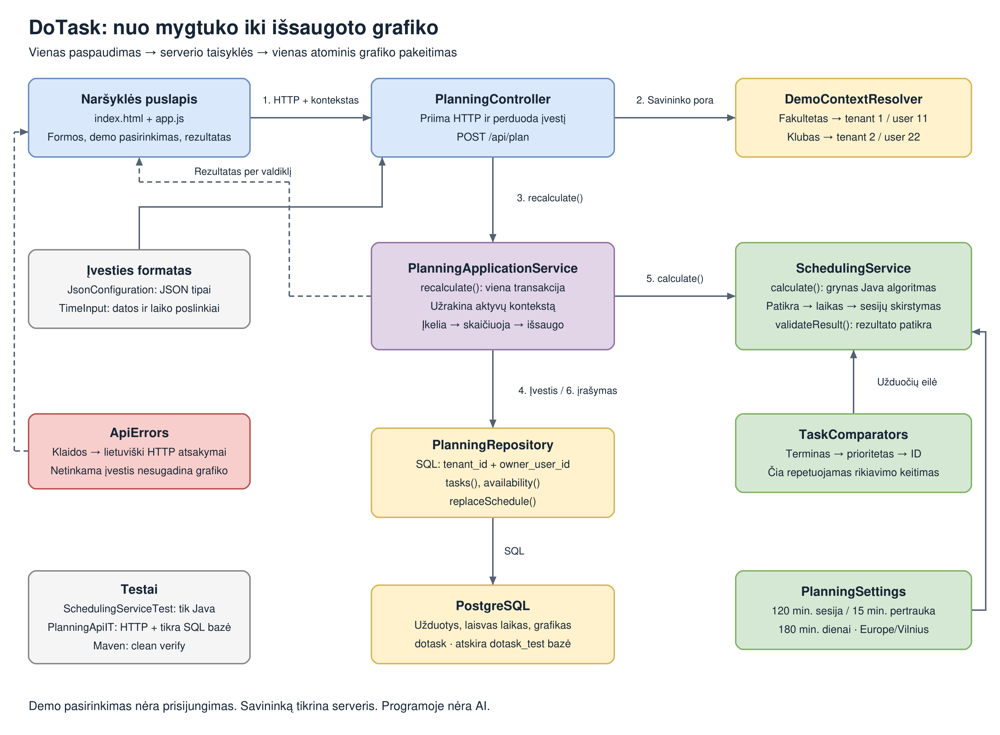

# DoTask gynimas: nuo pirmo perskaitymo iki mažo pakeitimo

Šis gidas parengtas iš pateiktos `DoTask_II_Gynimo_atmintine.md`, pritaikius ją tikram prototipui. Paleidimo ir API komandų pagrindinis šaltinis – [README](../README.md); patikrų faktai – [AUDITAS](AUDITAS.md). Nepakanka perskaityti tekstą: bent kartą pats atlik visą demonstraciją.

## Kaip dalys susijusios



[Atverti viso dydžio PNG schemą](SCHEMA.png). Tai „draw.io“ stiliaus paveikslas pagal tikrą kodą. Sek skaičius 1–6; punktyrinė rodyklė grąžina rezultatą per valdiklį atgal į puslapį.

## Kur daryti mažą pakeitimą

IntelliJ paspausk `Ctrl+N` ir įvesk klasės pavadinimą. Ilgesnis pavadinimas tiesiog nurodo atsakomybę; jo nereikia mokytis mintinai.

| Noriu pakeisti | Atidarau | Ką keičiu |
| --- | --- | --- |
| Užduočių eilę | `TaskComparators` | `deadlineFirst()` arba jau paruoštą `priorityFirst()`; sesijų ciklo neliečiu |
| Kuri eilė naudojama programoje | `DoTaskApplication` | `schedulingService()` perduodamą `Comparator`; numatyta `deadlineFirst()` |
| 120 / 15 / 180 nustatymus | `PlanningSettings` | `defaults()` skaičius; jie turi atitikti 15 min. taisykles |
| Darbo laiko skirstymą | `SchedulingService` | `calculate()` ir jo pagalbinius metodus |
| Visą grafiką išsaugoti vienu veiksmu | `PlanningApplicationService` | `recalculate()` – koordinavimas ir transakcija |
| Užklausos kelią ar laukus | `PlanningController` | HTTP metodą arba įvesties `record` |
| Duomenų atranką pagal savininką | `PlanningRepository` | SQL su `tenant_id` ir `owner_user_id` |
| JSON tekstinių laukų griežtumą | `JsonConfiguration` | `strictTextFields()`; tai įvesties formato patikra |

### Ką daro atidarytas `JsonConfiguration.java`?

JSON yra API siunčiamas tekstas, pvz., `{"title":"Java darbas"}`. Jackson biblioteka jį paverčia Java objektais. Ši maža klasė nustato, kad `{"title":123}` būtų klaida, o ne automatiškai paversta pavadinimu `"123"`. `textRules` yra tekstinių laukų taisyklės; trys eilutės atmeta sveikąjį skaičių, trupmeninį skaičių ir loginę reikšmę. `@Configuration` ir `@Bean` leidžia Spring pritaikyti šiuos nustatymus paleidimo metu.

Ilgas `Jackson2ObjectMapperBuilderCustomizer` yra bibliotekos tipo pavadinimas. Jo nepervadiname. Ši klasė neplanuoja laiko ir nekeičia prioritetų; rikiavimo repeticijai atverk `TaskComparators`. Griežtą JSON tikrina `PlanningApiIT.malformedJsonAndScalarTypesAreRejectedWithoutSaving`.

## Pirmiausia suprask penkis dalykus

1. **Ką gauna ir grąžina planuoklis?** Užduotis, laisvą laiką, aiškią planavimo pradžią ir nustatymus paverčia darbo sesijomis bei nesuplanuotu likučiu. Išsaugojimas savaime darbo neatlieka.
2. **Kas lemia eilę?** Pirma ankstesnis terminas, tada HIGH prieš MEDIUM prieš LOW, galiausiai mažesnis ID. Sesijai parenkamas ankstyviausias tinkamas tarpas.
3. **Ką reiškia 120 / 15 / 180?** Viena sesija iki 120 darbo minučių; tarp sesijų bent 15 min.; tą dieną iš viso iki 180 darbo minučių, sudėjus visas naudotojo užduotis. Pertrauka nėra darbas.
4. **Kas yra klientas?** Darbo erdvė „Fakultetas“ arba „Klubas“. Serverio SQL filtruoja ir erdvę, ir jos naudotoją. Demo pasirinkimas nėra prisijungimas.
5. **Kur įrodymas?** Tikslūs sesijų laikai, klaida ir nepakitęs išsaugotas grafikas, svetimo įrašo 404, konkretūs JUnit rezultatai. Galiu atidaryti taisyklę ir ją tikrinantį testą.

## 30–60 sekundžių įžanga

> DoTask padeda studentui suderinti užduotis su laisvu laiku. Įvedu terminus, prioritetus, likusią trukmę ir kada galiu dirbti. Programa apskaičiuoja sesijų grafiką, laikydamasi terminų, pertraukų ir bendro dienos limito. Jei viskas netelpa, matau nesuplanuotas minutes. II etape padarytas šis visas scenarijus, duomenų išsaugojimas, testai ir dviejų darbo erdvių atskyrimas. Planuoklis deterministinis, bet optimalaus rezultato negarantuoja. Prisijungimas, Docker, Android ir kokybės matavimai palikti vėlesniam etapui pagal II užduoties apimtį.

Sakyk tik tai, ką pats patikrinai. Nepristatyk Codex atliktos patikros kaip savo asmeniškai atliktos peržiūros.

## Tiksli demonstracijos eiga

1. Pagal README paruošk JDK, PostgreSQL ir aplinkos kintamuosius. IntelliJ terminale paleisk ` .\mvnw.cmd spring-boot:run `, atverk `http://localhost:8080`.
2. Pasirink **Fakultetas** ir atkurk fiksuotą I etapo pavyzdį. Patikrink pradžią **2026-10-05 18:00**, horizontą **3 dienos**, juostą **Europe/Vilnius**.
3. Perskaičiuok. Parodyk keturias sesijas: spalio 5 d. B 18:00–20:00, A 20:15–21:15; spalio 6 d. A 18:00–20:00 ir 20:15–21:15. A – 240, B – 120 min., likutis 0.
4. Pašalink tik spalio 6 d. prieinamumą **1002**, perskaičiuok. Lieka pirmos dienos dvi sesijos, A likutis **180** min. Tai galiojantis dalinis rezultatas.
5. Atkurk demo. README neteisingo redagavimo užklausa nusiųsk A trukmę **−15**. Parodyk 400 klaidą, tada **iš naujo per API** perskaityk grafiką ir užduotį. Grafikas nepakitęs, A vis dar 240 min. Senas naršyklės vaizdas vienas to neįrodo.
6. Vykdyk README izoliacijos bloką: Klubo užduoties **201** skaitymas, PUT ir DELETE Fakulteto kontekste grąžina 404; Klubo kontekste įrašas nepakitęs. Parodyk abiejų klientų atskirus sąrašus ir grafikus.
7. Kitame paruoštame terminale vykdyk ` .\mvnw.cmd clean verify `. Atverk testų suvestinę ir du konkrečius testus: bazinio pavyzdžio bei izoliacijos.
8. Atverk rikiavimo politiką, skirstymo ciklą ir transakciją. Parodyk mažą pakeitimą iš paskutinio šio gido skyriaus arba tiksliai paaiškink, kur ir kaip jį darytum.

Atkurti negalima, jeigu kontekste pridėta kitų, ne demo rinkinio, užduočių ar intervalų: serveris grąžina 409, kad jų neištrintų. Gynimo pavyzdžiui naudok skirtą demo rinkinį. Atkūrimas kitos erdvės neliečia.

### Paaiškink bazinio pavyzdžio skaičius

B turi ankstesnį terminą (spalio 6 d.), todėl pirmesnė už aukštesnio prioriteto A (spalio 7 d.). B sunaudoja 120 iš 180 spalio 5 d. darbo minučių. Po 15 min. pertraukos A gauna likusias 60. Nors iki 21:30 dar yra prieinamumo, dienos darbo limitas pasiektas.

Spalio 6 d. A gauna 120 ir 60 min., tarp jų 15 min. pertrauka. Pertrauka neskaičiuojama į 180 darbo minučių. Pašalinus antrą dieną A lieka 240 − 60 = **180** min. Nesumaišyk su atskirais testais: viena A ir 2 val. prieinamumo palieka **120**, viena A ir 180 min. dienos limitas palieka **60**.

## Ką atidaryti IntelliJ

Naudok `Ctrl+N` klasei, `Ctrl+Shift+F` tekstui, `Ctrl+B` metodo aprašui. Keliai lentelėje santykiniai projekto šaknies atžvilgiu.

| Klausimas | Failas ir vieta | Ką parodyti |
| --- | --- | --- |
| Kur pradedama programa? | `src/main/java/lt/dotask/DoTaskApplication.java`, `main` | `SpringApplication.run`, planuoklio priklausomybė |
| Kaip priimamas HTTP? | `src/main/java/lt/dotask/web/PlanningController.java` | `/api/plan`, konteksto gavimas, DTO pavertimas |
| Kur atmetamas klaidingas formatas? | `src/main/java/lt/dotask/web/JsonConfiguration.java`, `TimeInput.java`, `ApiErrors.java` | Tikrieji JSON tipai, aiškus laiko poslinkis ir mikrosekundžių tikslumas, lietuviškos klaidos |
| Kur nustatoma nuosavybė? | `src/main/java/lt/dotask/application/DemoContextResolver.java`, `resolve` | Dvi fiksuotos erdvės / naudotojo poros; nežinoma reikšmė atmetama |
| Kur transakcija? | `src/main/java/lt/dotask/application/PlanningApplicationService.java`, `recalculate` | `@Transactional`, konteksto užraktas, skaičiavimas ir pakeitimas |
| Kur eilė? | `src/main/java/lt/dotask/domain/TaskComparators.java`, `deadlineFirst`, `priorityFirst` | Aiškus prioritetų svoris, galutinė ID tvarka |
| Kur skirstomos minutės? | `src/main/java/lt/dotask/domain/SchedulingService.java`, `calculate` | Užduočių, langų ir tarpų ciklai, keturių dydžių minimumas |
| Kur paruošiamas laikas? | Tas pats failas, `normalize`, `roundUp` | Sujungimas, nukirpimas, vidurnaktis, 15 min. riba |
| Kodėl svarbios abi pertraukos pusės? | Tas pats failas, `freeGaps` | Esama sesija blokuoja laiką ir prieš save, ir po savęs |
| Kur tikrinamas rezultatas? | Tas pats failas, `validateResult` | Minučių sumos, ribos, pertraukos, terminai, dienos limitai |
| Kur SQL filtras? | `src/main/java/lt/dotask/persistence/PlanningRepository.java`, `task`, `updateTask`, `deleteTask` | `id` kartu su `tenant_id` ir `owner_user_id` |
| Kur keičiamas visas grafikas? | Tas pats failas, `replaceSchedule` | Šalinimas ir įterpimas toje pačioje taikomosios paslaugos transakcijoje |
| Kur demo duomenys? | `src/main/java/lt/dotask/application/DemoFixtures.java`, `tasks`, `availability` | Fiksuotos spalio datos, ID ir skirtingos erdvės |
| Kada demo inicijuojamas? | `src/main/java/lt/dotask/application/DemoInitializer.java`, `run` | `initializeDemo` tik naujam kontekstui |
| Kur schema ir konfigūracija? | `src/main/resources/schema.sql`, `application.properties` | Aiški nuosavybė, SQL saugojimas, aplinkos kintamieji |
| Kur paprasta sąsaja? | `src/main/resources/static/index.html`, `app.js` | Formos, HTTP užklausa, gauto rezultato rodymas |

## Vieno mygtuko paspaudimo kelias

1. Naršyklės „Perskaičiuoti“ paima įvestą pradžią ir dienų skaičių. Siunčia `POST /api/plan` su JSON `{"planningStart":"2026-10-05T18:00","horizonDays":3}` ir `X-Demo-Context: fakultetas`.
2. HTTP valdiklis patikrina formatą, `DemoContextResolver` grąžina serverio porą **tenant 1 / user 11**. Negalima JSON pridėti kito savininko.
3. `PlanningApplicationService.recalculate` pradeda transakciją ir užrakina konteksto eilutę, kad to paties naudotojo įvestis nebūtų keičiama skaičiuojant.
4. `PlanningRepository` atrenka tik šios poros užduotis ir prieinamumą. Ankstesnis sugeneruotas grafikas nėra papildomos nekeičiamos rezervacijos.
5. `SchedulingService.calculate` patikrina įvestį, paruošia intervalus, per `Comparator` surikiuoja užduotis, ieško ankstyviausių tarpų ir patikrina visą rezultatą.
6. Taikomoji paslauga patikrina užduočių nuosavybę. `replaceSchedule` pašalina seną šio konteksto grafiką ir įrašo naują. Jei įrašymas žlunga, transakcija atkuria ankstesnę būseną.
7. API grąžina sesijas ir likučius; naršyklė UTC reikšmes parodo Vilniaus laiku. Jokio AI iškvietimo šiame kelyje nėra.

## Sąvokos su vienu pavyzdžiu

| Sąvoka | Paprastas paaiškinimas ir DoTask pavyzdys |
| --- | --- |
| Godusis algoritmas | Imu kitą užduotį nustatyta eile ir duodu ankstyviausią tinkamą laiką. B gauna 18:00, neieškant visų galimų grafikų. |
| Deterministinis | Ta pati įvestis duoda tas pačias sesijas. Lygius terminus ir prioritetus galutinai išsprendžia ID. |
| `Comparator` | Pasako, kuris iš dviejų darbų pirmesnis. Jis gali pakeisti A/B eilę, bet neskaičiuoja sesijų trukmės. |
| Verslo taisyklė | Sistemos elgesio reikalavimas, pvz., sesija negali baigtis po termino. Tikrina Java, net apeinant puslapį. |
| Transakcija | Keli bazės pakeitimai pavyksta visi kartu arba atšaukiami. Po seno grafiko pašalinimo nepavykęs įterpimas neturi palikti tuščios pusės grafiko. |
| Klientas ir naudotojas | „Fakultetas“ – organizacija; naudotojas 11 – žmogus toje erdvėje. SQL tikrina abu, ne tik task ID. |
| API | HTTP adresai ir JSON susitarimas. `POST /api/plan` yra skaičiavimo užklausa. |
| Repository | Saugojimo užklausų vieta. `task(context,201)` Fakultete nesuranda Klubo įrašo. |
| Validavimas | Įvesties tinkamumo tikrinimas. −15 min. nėra dalinis planas – tai atmetama klaida. |
| Vienetinis testas | Tik Java algoritmas be Spring ir DB: tiksliai palyginamos keturios bazinės sesijos. |
| Integracinis testas | Kelių dalių ryšys: HTTP / taikomoji paslauga, nuosavybės SQL ir tikra testų bazė. |
| CRUD | Įrašo kūrimas, skaitymas, keitimas ir trynimas. Užduoties išsaugojimas dar nesukuria jokio grafiko, todėl vien CRUD neatitiktų pagrindinės funkcijos. |

## Testai: ką reikštų nesėkmė

Testuose rask tris dalis: paruoštus duomenis, iškvietimą ir konkrečią `assertEquals` / HTTP patikrą. `assertNotNull` vienas neįrodo teisingo laiko. Oficialus minimumas yra trys modulio testai ir vienas atskiras izoliacijos testas; papildomi atvejai pasirinkti pagal mūsų planavimo taisykles, ne dėl reikalaujamo padengimo procento.

| Atvejis | Ką turi įrodyti | Ką rodytų nesėkmė |
| --- | --- | --- |
| Bazinis pavyzdys | Visos keturios sesijos, A 240 / B 120, nuliniai likučiai | Neteisinga eilė, pertrauka arba bendras dienos limitas |
| Vienodi terminai | B HIGH prieš A MEDIUM; 15 min. tarpas | Prioritetų politika neteisinga |
| Per mažai laiko | A 120 suplanuotų ir 120 nesuplanuotų | Nepaisomas prieinamumas arba nesutampa minučių suma |
| Dienos limitas | A 120 + 60 suplanuotų, 60 likutis | Limitas skaičiuojamas neteisingai arba apima pertraukas |
| −15 minučių | Validavimo klaida; saugojime niekas nepakinta | Klaida priimama arba transakcija sugadina seną rezultatą |
| Pašalinta antra diena | A likutis 180, B 0 | Perskaičiavimas ignoruoja pakeistą įvestį |
| Lygybė iki ID | Mažesnis ID pirmas | Rezultatas gali priklausyti nuo DB eilučių tvarkos |
| Atliktos / pradelstos | Atliktos praleidžiamos, pradelstoms visas likutis | Planuojamas nebereikalingas ar jau neįmanomas darbas |
| Apvalinimas / persidengimas | Sesija tik nuo tinkamos 15 min. ribos | Laikas dubliuojamas arba planuojama per anksti |
| Vidurnaktis | Atskiros vietinės dienos ir jų limitai | Sesija priskiriama neteisingai dienai |
| Įterpimas prieš kitą sesiją | Pertrauka lieka iš abiejų pusių | Tikrinama tik ankstesnė sesija |
| Pakartojimas | Tas pats grafikas be dublikatų; likęs darbas nesumažėja | Senos sesijos naudojamos kaip papildomos rezervacijos |
| Svetimas ID | 404 skaitymui / keitimui / trynimui, svetimas įrašas nepakitęs | Nuosavybė tik paslėpta UI arba SQL filtras nepilnas |
| Nutrūkęs pakeitimas | Ankstesnis grafikas išlieka visas | Šalinimas ir įterpimas nėra viena transakcija |

Tikslūs metodai, kuriuos verta atsidaryti:

- `src/test/java/lt/dotask/domain/SchedulingServiceTest.java`: `baseExampleMatchesAllFourSessionsAndSharedDailyLimit`, `equalDeadlinesUseHigherPriorityAndPreserveBreak`, `shortageLeavesExactly120Minutes`, `dailyLimitLeavesExactly60Minutes`, `rejectsInvalidUnfinishedMinutes` – penki I plano scenarijai.
- Tame pačiame faile: `removingSecondDayLeaves180MinutesForA`, `freeGapBeforeLaterSessionReservesBreakOnBothSides`, `midnightSplitsDailyWorkAndPreservesBreak`, `explicitOffsetsAcrossAutumnClockChangeUseElapsedMinutes` – demo pakeitimas ir sunkesnės laiko ribos.
- `src/test/java/lt/dotask/application/PlanningApiIT.java`: `invalidEditAndInvalidCalculationLeaveExactSavedScheduleUnchanged` – iš tikros testų bazės vėl skaitomas ankstesnis grafikas; `failedReplacementRollsBackDeletionInsertionAndMetadata` – kontroliuojama įrašymo klaida tikrina transakcijos atšaukimą.
- Tame pačiame integraciniame faile: `foreignTaskCannotBeReadUpdatedOrDeletedThroughHttp`, `foreignAvailabilityAndSchedulesAreScopedAndResetDoesNotTouchOtherClient`, `compositeForeignKeyRejectsSessionReferencingOtherTenant` – serverio / saugojimo izoliacija, ne JavaScript filtravimas.
- `PlanningApiIT.jsonResponsesDeclareUtf8AndPreserveLithuanianText` – lietuviškas pavadinimas ir klaida išlieka taisyklingi, o HTTP atsakymas aiškiai nurodo UTF-8 koduotę.

Tikslinei algoritmo patikrai: ` .\mvnw.cmd '-Dtest=SchedulingServiceTest' test `. Visam vertinamam rinkiniui reikia `clean verify`, nes vien `test` fazė nevykdo Failsafe `*IT`.

## Tikėtini klausimai

**Ar grafikas optimalus?** Ne. Pasirinkta godžioji strategija. Likutis aprašo jos rezultatą, o ne matematinį įrodymą, kad jokia kita eilė netiktų.

**Kodėl B pirma, nors A prioritetas HIGH?** Numatytas `Comparator` pirmiausia lygina terminus. B terminas diena ankstesnis.

**Kodėl tikrini abi sesijos puses?** Nauja užduotis gali būti įterpta prieš jau suplanuotą vėlesnę sesiją. Reikia palikti pertrauką ir iki jos, ne tik po ankstesnės.

**Ar pertrauka reikalauja laisvo intervalo?** Ji nėra darbo sesija, todėl gali būti natūralus tarpas už prieinamumo. Darbo sesija visa turi tilpti į prieinamumą.

**Ką darai ties laikrodžio persukimu?** Java viduje naudoju `Instant`, dienas nustatau pagal Europe/Vilnius. Neaiškiam vietiniam laikui API reikalauja galiojančio aiškaus poslinkio; neegzistuojantį atmeta. Dienos horizontas yra vietinės kalendorinės dienos.

**Kas atsitinka pakeitus užduotį?** Galiojantį redagavimą išsaugau ir seną grafiką pažymiu pasenusiu. Ištrynus užduotį, jos senos sesijos ir likutis taip pat pašalinami pagal DB ryšį, o likusi grafiko dalis pažymima pasenusia. Visas naujas grafikas apskaičiuojamas tik perskaičiavus. Netinkamas redagavimas neišsaugomas ir visą seną grafiką palieka nepakeistą.

**Ar tai saugus prisijungimas?** Ne. Demo pasirinkimas leidžia parodyti dvi aplinkas. Jo kontekste serverio užklausos izoliuotos, bet tapatybės ir narystės kontrolę dar reikia įgyvendinti.

**Ar programoje yra AI?** Ne. Java taisyklės apskaičiuoja rezultatą; mokamos paslaugos ar rakto nereikia. Codex buvo kūrimo asistentas.

**Kodėl nėra Docker, Android ar matavimų?** II PDF apimtis leidžia ribotą prototipą. Prisijungimas, konteineriai ir kokybės įrodymai palikti III etapui, Android – vėlesniam planui. Tai etapų riba, ne kitos sistemos pasirinkimas.

**Kodėl PostgreSQL ir ne JavaFX?** I plano serveris yra Java / Spring Boot REST su PostgreSQL ir paprastu naršyklės puslapiu. IntelliJ yra kūrimo aplinka, ne reikalavimas desktop sąsajai.

**Kur matyti atsakomybės?** Algoritmas neturi Spring ar SQL importų. Valdiklis priima HTTP, paslauga valdo transakciją, repository vykdo SQL, `Comparator` nustato eilę.

**Ar viską parašei pats?** Atsakyk pagal faktus: Codex rengė kodą, testus ir dokumentaciją. Papildomai įvardyk tik tas dalis, kurias pats perskaitei, išbandei ir gali pakeisti. Nesakyk, kad jau supranti viską, jei dar neperžiūrėjai.

## Pakeitimo repeticija: pirmiau prioritetas

Atverk `src/main/java/lt/dotask/domain/TaskComparators.java`. Numatytoji `deadlineFirst()` politika lieka nepakeista. Naujas `priorityFirst()` palyginimas pirmiausia lygina prioriteto svorį mažėjimo tvarka, tada terminą ir ID. Jis jau pridėtas kaip mažas pakeitimo pavyzdys; perskaityk ir pabandyk jį pats atkurti atskiroje kopijoje.

Sukurk planuoklį su `new SchedulingService(TaskComparators.priorityFirst())`. Nekeisk skirstymo ciklo ar pagrindinės programos numatytojo `deadlineFirst()` pasirinkimo. Testo duomenys:

| Įvestis | Reikšmė |
| --- | --- |
| Pradžia ir prieinamumas | 2026-10-05 18:00; 18:00–20:15 |
| A | 60 min., LOW, terminas 2026-10-06 21:30 |
| B | 60 min., HIGH, terminas 2026-10-07 21:30 |
| Nustatymai | 120 sesija / 15 pertrauka / 180 diena |

| Politika | 18:00–19:00 | 19:15–20:15 |
| --- | --- | --- |
| `deadlineFirst()` | A | B |
| `priorityFirst()` | B | A |

Tai parodo: pasikeitė užduočių eilė, o terminų, pertraukų ir dienos limito taisyklės liko tame pačiame algoritme. Formalus III etapo „0 pakeistų failų“ įrodymas šiam prototipui nereikalaujamas.

Tikras pavyzdys yra `SchedulingServiceTest.priorityFirstComparatorChangesOrderWithoutChangingAllocator`. Jį paleisi:

```powershell
.\mvnw.cmd '-Dtest=SchedulingServiceTest#priorityFirstComparatorChangesOrderWithoutChangingAllocator' test
.\mvnw.cmd clean verify
```

Papildomas pratimas: teste pakeisk `new PlanningSettings(120, 15, 180)` į `new PlanningSettings(120, 30, 180)` ir prieinamumą į 18:00–20:30. Dviem 60 min. užduotims antroji sesija turi tapti **19:30–20:30**. Keiti nustatymo įvestį, ne laiko skirstymo algoritmą.

Dar mažesnis pratimas: `SchedulingService.validateTask` naudojamą trukmės klaidos tekstą pataisyk į aiškesnį lietuvišką sakinį. Patikrink, kad −15 vis tiek atmetama. Prieš gynimą atkurk numatytus nustatymus ir paleisk visą patikrą.

## Ko dar nereikia teigti

Nėra prisijungimo ar produkcinės tapatybės apsaugos, individualių nustatymų redaktoriaus, Android, offline, išorinio kalendoriaus, priklausomybių tarp darbų ar našumo įrodymo. H2 integracinė patikra viena neįrodo visų PostgreSQL savybių. Faktiniai PostgreSQL ir naršyklės bandymai nurodomi audite. GitHub pagal naudotojo prašymą tvarkomas atskirai; prieš gynimą būtinas tikras push į tą pačią I etapo repozitoriją.
